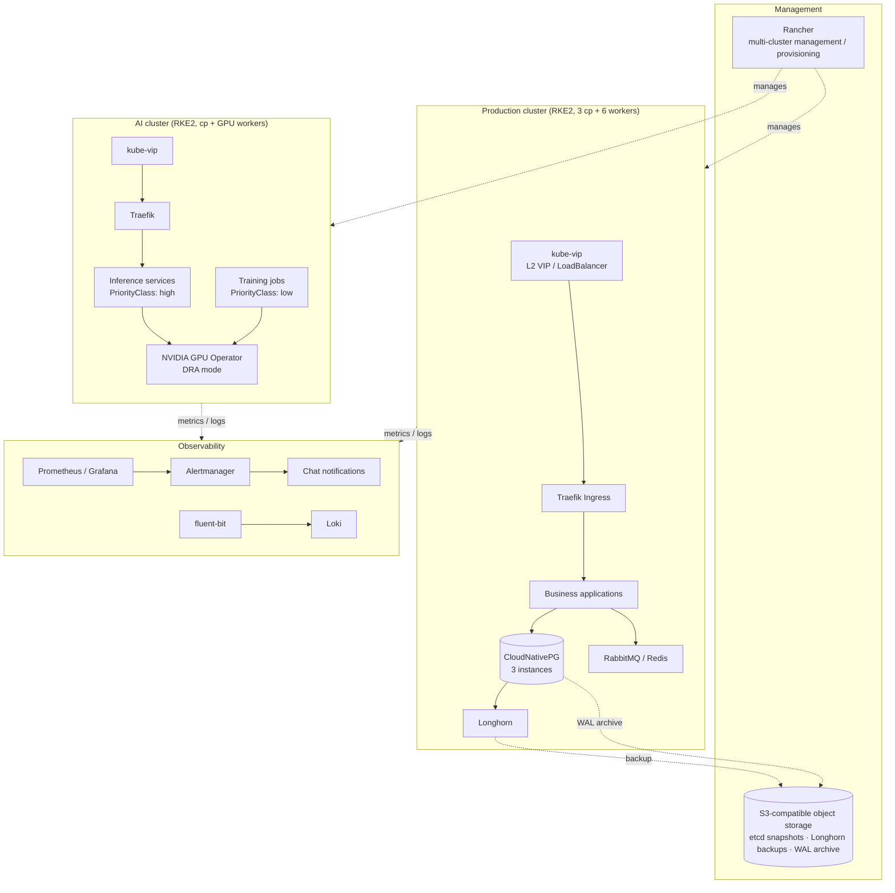

# On-prem Kubernetes platform

[繁體中文](README.zh-TW.md)

A reference architecture for running several Kubernetes clusters on bare metal and VMs, with no managed
cloud services. It covers cluster lifecycle, distributed storage, GPU scheduling, observability and
disaster recovery.

Everything here is rewritten from real operations work and de-identified. Hostnames, IPs, domains and
applications are example values; there is no real environment configuration and no secrets.

## Background

An enterprise intranet has no managed Kubernetes, no cloud load balancer and no hosted database. Clusters,
storage, load balancing, certificates and monitoring all have to be run in-house, on hardware that is not
always good, a network that is not always stable, and a very small operations team. Most of what is in this
repository exists because something broke under those conditions.

## What it covers

Rancher provisions and upgrades the RKE2 clusters. One cluster runs production business workloads and a
second one runs GPU AI workloads.

Ingress works without a cloud load balancer. kube-vip provides the VIP and LoadBalancer services, Traefik
routes by hostname with a default wildcard certificate, and plain HTTP always redirects to HTTPS.

Data protection is layered. Longhorn takes snapshots and backs volumes up to S3; a PVC opts in by adding a
label. CloudNativePG runs PostgreSQL in HA with WAL archiving to the same S3 storage. A node shutdown hook
protects Longhorn volumes when a machine is powered off.

GPUs are allocated by the NVIDIA GPU Operator in Dynamic Resource Allocation (DRA) mode, and PriorityClasses
make inference preempt training when the cluster is full.

The [postmortems](#postmortems) document real incidents from symptom to prevention: etcd losing quorum, a
network partition that corrupted a filesystem, and WAL filling a disk.

## Architecture



The design and its trade-offs are described in [docs/architecture.md](docs/architecture.md).

## Tech stack

| Layer | Choice |
|---|---|
| Cluster management | Rancher, RKE2 |
| Networking | Calico, kube-vip (L2 VIP and LoadBalancer), NodeLocal DNSCache |
| Ingress | Traefik, including Gateway API; the wildcard certificate is copied across namespaces by Reflector |
| Storage | Longhorn, with snapshots and S3 backups; volumes join a backup group by label |
| Database | CloudNativePG (HA with WAL archiving), single-instance PostgreSQL |
| GPU | NVIDIA GPU Operator with Dynamic Resource Allocation |
| Monitoring | kube-prometheus-stack, Alertmanager to a chat webhook |
| Logging | fluent-bit to Loki |

## Repository layout

```
docs/
  architecture.md            Overall architecture and design trade-offs
  postmortems/               Incident reviews: symptom, investigation, root cause, fix, prevention
  adr/                       Architecture decision records
platform/
  node-shutdown-protection/  Two safeguards for Longhorn volumes when a node shuts down
  longhorn/                  Recurring snapshot and backup schedules
  scheduling/                PriorityClasses for inference and training
  gpu/                       Example of allocating GPUs with DRA
scripts/
  check-sanitized.sh         De-identification check run before publishing
```

## Postmortems

| # | Incident | What I learned |
|---|---|---|
| [0001](docs/postmortems/0001-etcd-quorum-loss-on-slow-disk.md) | Adding an etcd member took down the cluster API | Going from one member to two is when quorum is most fragile, and etcd is very sensitive to disk latency |
| [0002](docs/postmortems/0002-network-partition-longhorn-fs-corruption.md) | A partial network partition corrupted a database filesystem, then WAL filled the disk | The 300 s default for taint-based eviction kills the storage engine; cloned VMs had duplicate disk UUIDs; replication slots need a size limit |

## Operating principles

1. Every change is tried on a test cluster first. The same scripts target either cluster through environment variables.
2. A backup only counts once it has been restored. Restoring etcd and volumes from S3 is rehearsed regularly.
3. Alerts cover things that are broken but quiet, such as a database Cluster stuck at `Ready=False`, not only Pod restarts.
4. An operation that fails is better than one that silently destroys data. For example, the shutdown drain never uses `--force`.
