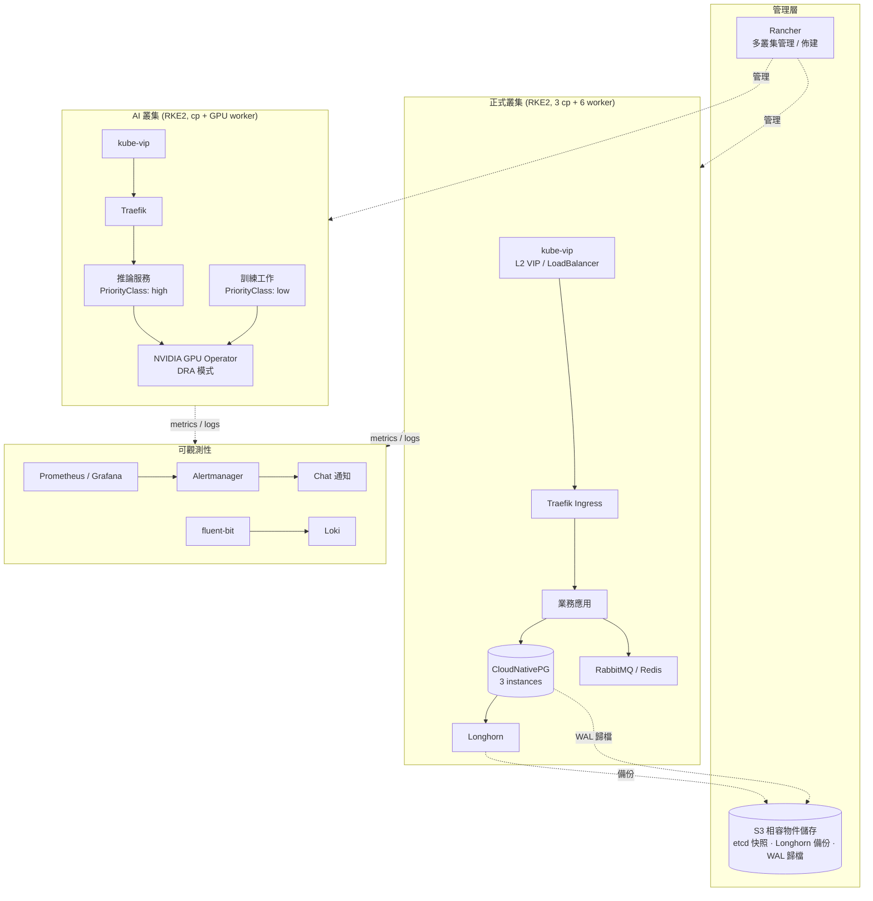

# 地端 Kubernetes 平台

[English](README.md)

在實體機與 VM 上維運多座 Kubernetes 叢集的參考架構，不依賴任何雲端託管服務。
內容涵蓋叢集生命週期、分散式儲存、GPU 排程、可觀測性與災難復原。

這裡的內容都是從實際維運工作改寫並去識別化。主機名稱、IP、網域與應用程式都是範例值，
不含任何真實環境設定或機密。

## 背景

企業內網沒有託管的 Kubernetes，沒有雲端負載平衡，也沒有託管資料庫。叢集、儲存、負載平衡、
憑證、監控都得自己維運，而且硬體不一定好、網路不一定穩、維運人力很少。
這個 repo 裡大部分的東西，都是因為在這種條件下出過事才做出來的。

## 涵蓋範圍

Rancher 負責佈建與升級 RKE2 叢集。一座叢集跑正式業務，另一座跑 GPU AI 工作負載。

入口不靠雲端負載平衡。kube-vip 提供 VIP 和 LoadBalancer Service，Traefik 依網域分流並套用預設的萬用憑證，
HTTP 一律轉到 HTTPS。

資料保護分成幾層。Longhorn 做快照並把 volume 備份到 S3，PVC 加上 label 就會納入備份。
CloudNativePG 以 HA 模式跑 PostgreSQL，WAL 歸檔到同一套 S3。節點關機時另有機制保護 Longhorn volume。

GPU 由 NVIDIA GPU Operator 以 Dynamic Resource Allocation（DRA）模式配發，
叢集資源不夠時，PriorityClass 讓推論優先於訓練。

[事故檢討](#事故檢討)記錄了實際發生過的事故，從症狀一路寫到預防：etcd 失去 quorum、
網路分區造成檔案系統損毀、WAL 把磁碟寫滿。

## 架構



設計與取捨的說明見 [docs/architecture.zh-TW.md](docs/architecture.zh-TW.md)。

## 技術棧

| 層次 | 選擇 |
|---|---|
| 叢集管理 | Rancher、RKE2 |
| 網路 | Calico、kube-vip（L2 VIP 與 LoadBalancer）、NodeLocal DNSCache |
| Ingress | Traefik（含 Gateway API），萬用憑證由 Reflector 複製到各 namespace |
| 儲存 | Longhorn，快照加 S3 備份，以 label 加入備份群組 |
| 資料庫 | CloudNativePG（HA 與 WAL 歸檔）、單實例 PostgreSQL |
| GPU | NVIDIA GPU Operator，Dynamic Resource Allocation |
| 監控 | kube-prometheus-stack，Alertmanager 送到 Chat webhook |
| 日誌 | fluent-bit 送到 Loki |

## Repo 結構

```
docs/
  architecture.md            整體架構與設計取捨
  postmortems/               事故檢討：症狀、排查、根因、修復、預防
  adr/                       架構決策紀錄
platform/
  node-shutdown-protection/  節點關機時保護 Longhorn volume 的兩道防線
  longhorn/                  定期快照與備份排程
  scheduling/                推論與訓練的 PriorityClass
  gpu/                       用 DRA 配發 GPU 的範例
scripts/
  check-sanitized.sh         發佈前的去識別化檢查
```

每份文件都有英文版（`.md`）與中文版（`.zh-TW.md`）。

## 事故檢討

| # | 事故 | 學到的事 |
|---|---|---|
| [0001](docs/postmortems/0001-etcd-quorum-loss-on-slow-disk.zh-TW.md) | 新增 etcd 節點拖垮整個叢集 API | 從一個節點擴成兩個的那一刻 quorum 最脆弱，而且 etcd 對磁碟延遲非常敏感 |
| [0002](docs/postmortems/0002-network-partition-longhorn-fs-corruption.zh-TW.md) | 網路局部分區造成資料庫檔案系統損毀，接著 WAL 把磁碟寫滿 | taint-based eviction 預設的 300 秒會殺掉儲存引擎；複製出來的 VM 有重複的 disk UUID；replication slot 要設上限 |

## 維運原則

1. 所有變更先在測試叢集試過。同一套腳本用環境變數切換目標叢集。
2. 備份要真的還原過才算數。定期演練從 S3 還原 etcd 與 volume。
3. 告警要能抓到「壞了但沒人發現」的狀態，例如資料庫 Cluster 卡在 `Ready=False`，而不只是 Pod 重啟。
4. 寧可操作失敗，也不要靜默毀掉資料。例如關機時的 drain 一律不加 `--force`。
